<p align="center">
  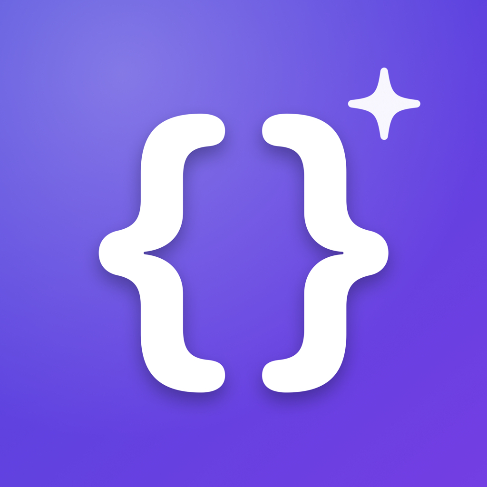
</p>

<h1 align="center">SwiftExtension</h1>

<p align="center">
  Small, tested, dependency-free extensions for <b>Foundation</b>, <b>UIKit</b> and <b>SwiftUI</b>.<br>
  Add one Swift package. Browse every helper in a live catalog app.
</p>

<p align="center">
  <a href="https://github.com/ANSCoder/Swift-Extension/actions/workflows/ci.yml"></a>
  <a href="https://github.com/ANSCoder/Swift-Extension/actions/workflows/codeql.yml"></a>
  <a href="https://swiftpackageindex.com/ANSCoder/Swift-Extension"></a>
  <a href="https://swiftpackageindex.com/ANSCoder/Swift-Extension"></a>
  
  
  <a href="LICENSE"></a>
</p>

<p align="center">
  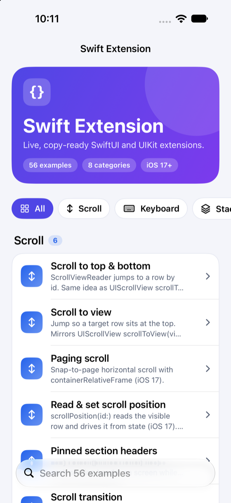
  &nbsp;
  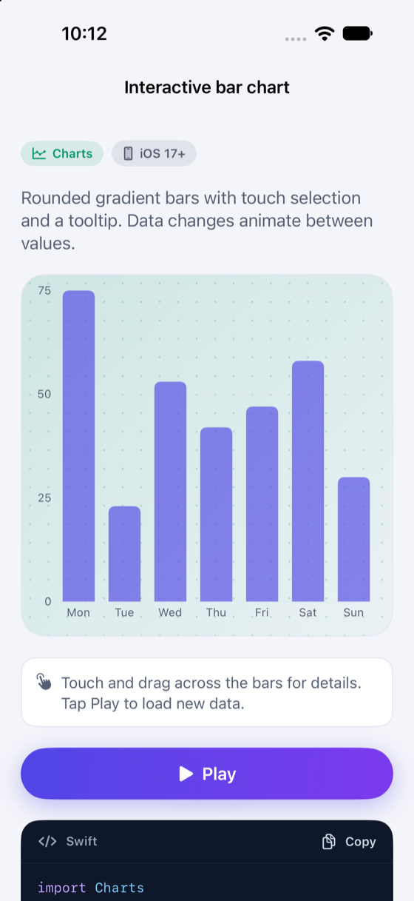
  &nbsp;
  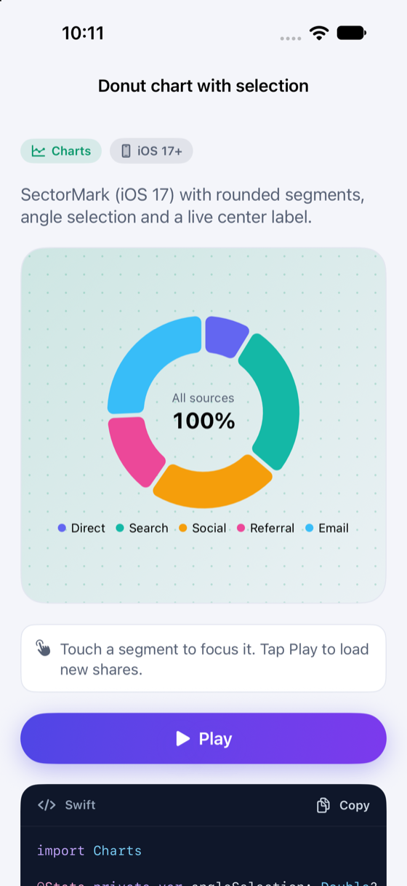
</p>

## Contents

[Why](#why) · [Installation](#installation) · [Quick start](#quick-start) · [API](#api) · [Catalog app](#catalog-app) · [Animations](#animations) · [Concurrency and safety](#concurrency-and-safety) · [Requirements](#requirements) · [Documentation](#documentation) · [Contributing](#contributing) · [Project health](#project-health) · [License](#license)

## Why

- **One import, many small helpers.** Each extension is independent and documented with an example. No framework to learn.
- **See it before you use it.** A catalog app runs all 56 examples live. Every screen has a **Play** button and the exact code.
- **Production habits.** Swift 6 language mode with strict concurrency, public API documented with DocC, 87% test coverage, warnings treated as errors in CI.
- **Accessible by default.** Dynamic Type, VoiceOver and Reduce Motion are respected. State is never shown by color alone.
- **No dependencies.** Only Apple frameworks.

## Installation

### Swift Package Manager

**Xcode:** File → Add Package Dependencies, then enter

```
https://github.com/ANSCoder/Swift-Extension
```

**Package.swift:**

```swift
dependencies: [
    .package(url: "https://github.com/ANSCoder/Swift-Extension", from: "1.0.0")
],
targets: [
    .target(name: "YourApp", dependencies: ["SwiftExtension"])
]
```

Then:

```swift
import SwiftExtension
```

### Copy a single file

Every file in [`Sources/SwiftExtension`](Sources/SwiftExtension) works on its own. Copy only what you need, and add `public` if you share it across modules. `ExString` uses `DateFormatter.posix` from `ExDate`, and the SwiftUI view helpers use `FirstAppearModifier` and `SizePreferenceKey`.

## Quick start

```swift
import SwiftExtension
import SwiftUI

struct ProfileView: View {
    @State private var email = ""
    @State private var errorMessage: String?
    @State private var isSaving = false

    var body: some View {
        Form {
            TextField("Email", text: $email)
            Label(email.isEmail ? "Valid" : "Invalid", systemImage: email.isEmail ? "checkmark.circle" : "xmark.circle")
                .hidden(if: email.isEmpty)
        }
        .loadingOverlay(isSaving)
        .errorAlert(message: $errorMessage)
        .dismissKeyboardOnTap()
    }
}
```

## API

Foundation helpers build on every platform in the package. UIKit and SwiftUI helpers are compiled where UIKit exists.

### Foundation

| Type | Helpers |
| --- | --- |
| `String` | `isEmail`, `isMobile`, `isAlphanumeric`, `isValidURL`, `initials`, `trim`, `trimLine`, `removeSpace`, `firstLetterCapitalized`, `truncated(to:)`, `changeDate(_:)` |
| `Date` | `toString()`, `toTimeString()`, `isToday`, `isSameDay(as:)`, `startOfDay`, `adding(_:value:)` |
| `Array`, `Collection`, `Sequence` | `atIndex(_:)`, `chunked(into:)`, `isNotEmpty`, `removingDuplicates(on:)` |
| `Comparable` | `clamped(to:)` |
| `Double` | `rounded(toPlaces:)` |
| `Optional<String>` | `orEmpty` |
| `Encodable` | `asDictionary()` |
| `URL` | `queryItems`, `appendingQueryItems(_:)` |
| `Bundle` | `appVersion`, `buildNumber` |

### SwiftUI

| Helper | What it does |
| --- | --- |
| `if(_:transform:)`, `ifLet(_:transform:)` | Apply a modifier only when a condition holds or a value exists |
| `hidden(if:)` | Hide a view and keep its layout space |
| `onFirstAppear(perform:)` | Run once, ignoring later appearances |
| `onSizeChange(perform:)` | Report the rendered size |
| `loadingOverlay(_:)` | Dim, spinner, block taps |
| `errorAlert(_:message:)` | OK alert bound to an optional message |
| `dismissKeyboardOnTap()` | Resign first responder on tap. Unavailable in app extensions |
| `cardStyle(cornerRadius:)`, `roundedBorder(_:width:cornerRadius:)` | Card background and stroke |
| `shake(trigger:)` | Wobble on change. Skipped when Reduce Motion is on |
| `shimmer(_:)`, `redactedShimmer(_:)` | Loading skeleton with a moving highlight |
| `snapshot(scale:)` | Render a view into a `UIImage` |
| `Color(hex:)` | `#RRGGBB`, `RRGGBB` or `RRGGBBAA` |

### UIKit

| Type | Helpers |
| --- | --- |
| `UIColor` | `init(hex:)`, `hexString` |
| `UIView` | `addSubviews(_:)`, `pinToEdges(of:insets:)` (right-to-left aware) |
| `UILabel` | `setLeft()`, `setRight()`, `underline()`, `attribute(_:effect:)` |
| `UIViewController` | `showAlertView(title:message:)`, `showAlertWithMessage(_:duration:with:)` |
| `UIScrollView` | `scrollToView(view:animated:)`, `scrollToTop(animated:)`, `scrollToBottom(animated:)` |
| `UINavigationBar` | `setTitleFont(_:color:)`, `makeTransparent(withTint:)`, `setColors(background:text:)` |
| `UITextField` | `setBorderAndCorner(color:)`, `setLeftPaddingPoints(_:)`, `setRightPaddingPoints(_:)`, `isValidEmail`, `isPhoneNumber` |
| `UIImage` | `toBase64String`, `resized(by:)`, `halfSizeImage`, `quarterhalfSizeImage` |
| `UIImageView` | `setRounded()`, `setCornerRadius()` |
| `NSMutableAttributedString` | `bold(_:size:)`, `normal(_:)` |

## Catalog app

Open `Example/Swift-Extension.xcodeproj` and run it. It uses the package from the repository root, so it always shows the real code.

| Category | Examples |
| --- | --- |
| Scroll (6) | scroll to top/bottom, scroll to view, paging, scroll position, pinned headers, scroll transition |
| Keyboard (4) | dismiss on tap, scroll dismisses, focus chain, keyboard toolbar |
| Stacks & Layout (5) | alignment, Grid, adaptive grid, ViewThatFits, custom FlowLayout |
| Text (4) | Markdown & AttributedString, Dynamic Type scaling, numeric transition, date styles |
| Animations (20) | spring, implicit, transitions, matched geometry, PhaseAnimator, KeyframeAnimator, symbol effects, shake, drag spring, TimelineView, shimmer, confetti, radar pulse, draw-on checkmark, liquid wave, progress ring, card stack, aurora gradient, sliding segments, 3D tilt |
| Charts (6) | interactive bars, line & area, donut with selection, stacked bars (absolute / 100%), scrollable time series, KPI cards with sparklines |
| View Modifiers (6) | card style, conditional modifiers, loading overlay, error alert, size & first appear, view to image |
| Foundation (5) | validation, date helpers, string helpers, number helpers, URL & Bundle helpers |

## Animations

Recorded from the catalog app. Every one is plain SwiftUI. The code is on its example screen.

<table>
  <tr>
    <td align="center">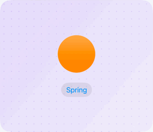<br><sub><b>Spring</b></sub></td>
    <td align="center">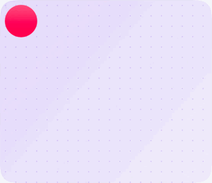<br><sub><b>Matched geometry</b></sub></td>
    <td align="center"><br><sub><b>Phase animator</b></sub></td>
  </tr>
  <tr>
    <td align="center">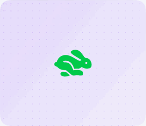<br><sub><b>Keyframes</b></sub></td>
    <td align="center">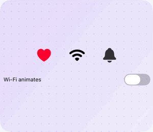<br><sub><b>SF Symbol effects</b></sub></td>
    <td align="center">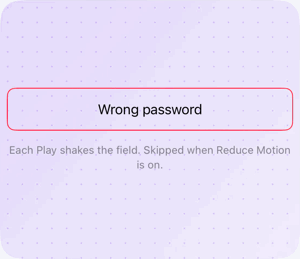<br><sub><b>Shake on error</b></sub></td>
  </tr>
  <tr>
    <td align="center">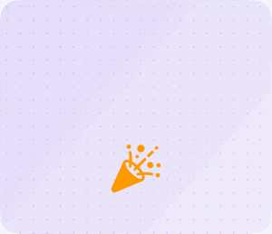<br><sub><b>Confetti burst</b></sub></td>
    <td align="center">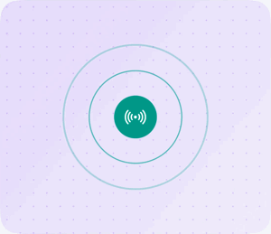<br><sub><b>Radar pulse</b></sub></td>
    <td align="center">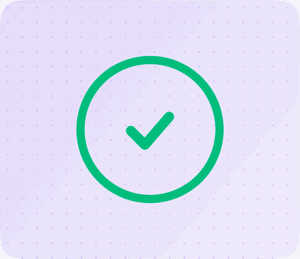<br><sub><b>Draw-on checkmark</b></sub></td>
  </tr>
  <tr>
    <td align="center">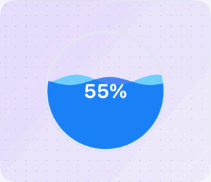<br><sub><b>Liquid wave gauge</b></sub></td>
    <td align="center">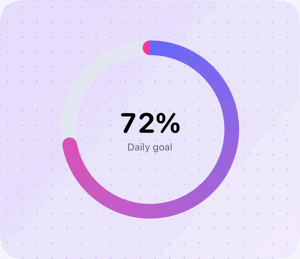<br><sub><b>Progress ring</b></sub></td>
    <td align="center">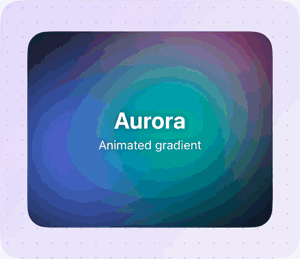<br><sub><b>Aurora gradient</b></sub></td>
  </tr>
  <tr>
    <td align="center">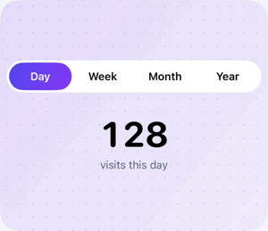<br><sub><b>Sliding segments</b></sub></td>
    <td align="center">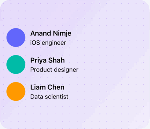<br><sub><b>Skeleton shimmer</b></sub></td>
    <td align="center">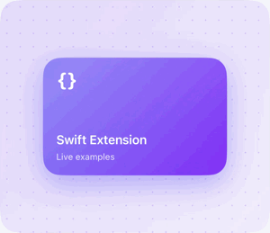<br><sub><b>3D tilt card</b></sub></td>
  </tr>
  <tr>
    <td align="center">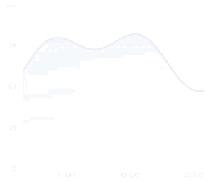<br><sub><b>Line & area chart</b></sub></td>
    <td align="center">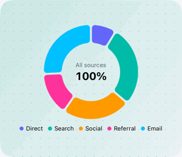<br><sub><b>Donut chart</b></sub></td>
  </tr>
</table>

## Concurrency and safety

The package builds in **Swift 6 language mode** with complete strict concurrency checking, and CI treats warnings as errors.

- No `@unchecked Sendable`, `nonisolated(unsafe)`, `@preconcurrency`, locks or semaphores.
- `Date.toString()` and `toTimeString()` use value-type `FormatStyle`s, so there is no shared `DateFormatter`.
- `UIViewController.showAlertWithMessage` waits with a main-actor `Task`, not a dispatch timer.
- UIKit and SwiftUI helpers run on the main actor. Foundation helpers are plain value-type code.
- No force unwraps or `try!` in library code. Inputs at boundaries return `nil`, `false` or an empty value instead of crashing.
- UIKit and SwiftUI code sits inside `#if canImport(UIKit)`, so `swift build` works on macOS.

## Requirements

| | |
| --- | --- |
| Swift | 6.0 or later (Swift 6 language mode) |
| Xcode | 16 or later. CI runs the latest stable Xcode |
| iOS | 17.0+ (all helpers) |
| macOS | 14.0+ (Foundation helpers only) |
| Dependencies | None. The catalog's Charts examples use Apple's Swift Charts |

## Documentation

- API reference built with DocC. Preview it in Xcode with **Product → Build Documentation**. It is hosted by the [Swift Package Index](https://swiftpackageindex.com/ANSCoder/Swift-Extension/documentation/swiftextension) once the package is listed.
- Every public declaration has a `///` comment with a usage example.
- [CHANGELOG](CHANGELOG.md) · [Maintaining](docs/MAINTAINING.md)

## Development

```bash
swift build                      # Foundation helpers on the macOS host
swift test                       # Foundation tests on the macOS host

xcodebuild test -scheme SwiftExtension \
  -destination 'platform=iOS Simulator,name=iPhone 17'      # everything, on a simulator

xcrun swift-format lint --strict --recursive Sources Tests   # style
```

### Add an example to the catalog

1. Create `Example/Swift-Extension/Catalog/Demos/<Category>/MyDemo.swift` with a view that takes `play: Int` and a `static let info = ExampleInfo(...)`.
2. Add a case to `Example/Swift-Extension/Catalog/Core/Example.swift` and fill in its three switches: `info`, `playHint` and `demo`.
3. Run the example tests. `CatalogTests` fails if a title, summary, code or hint is missing, or if titles repeat.

### Recording the GIFs

The catalog has two launch arguments for documentation:

```bash
xcrun simctl launch booted anscoder.Swift-Extension -example confetti   # bare auto-playing stage
xcrun simctl launch booted anscoder.Swift-Extension -detail barChart    # one example screen
```

Record with `xcrun simctl io booted recordVideo`, then crop the stage and convert to GIF.

## Contributing

Issues and pull requests are welcome. Read [CONTRIBUTING.md](CONTRIBUTING.md) first. By taking part you agree to the [Code of Conduct](CODE_OF_CONDUCT.md). Report security problems privately, see [SECURITY.md](SECURITY.md).

## Project health

| | |
| --- | --- |
| **CI** | Format, macOS build and tests, iOS simulator tests with coverage, example app, DocC build. One required check: `CI success` |
| **Security** | CodeQL for Swift on every PR and weekly. Dependabot for GitHub Actions and Swift packages |
| **Review bots** | [Danger](dangerfile.js) PR checks, [CodeRabbit](.coderabbit.yaml) and GitHub Copilot review ([instructions](.github/copilot-instructions.md)), auto-labeling, release drafting |
| **Releases** | Semantic versioning. Pushing a tag like `1.0.0` runs the tests and publishes a GitHub release |

## Migrating from the Swift 4 version

- Minimum is now iOS 17 and Swift 6. Add the package instead of copying files.
- `changeDate(_:)` and `UIImage.toBase64String` return optionals instead of crashing.
- `UINavigationBar` helpers use `UINavigationBarAppearance`. The default title color is `.label`.
- `showAleartViewwithTitle` and `setCornerRadious` still work but are deprecated.
- `ExFunction` is now an `enum` namespace. Its static methods are unchanged.

## License

MIT. See [LICENSE](LICENSE).

Animation topics were inspired by [awesome-ios-animation](https://github.com/onmyway133/awesome-ios-animation) and [awesome-swift](https://github.com/matteocrippa/awesome-swift).
